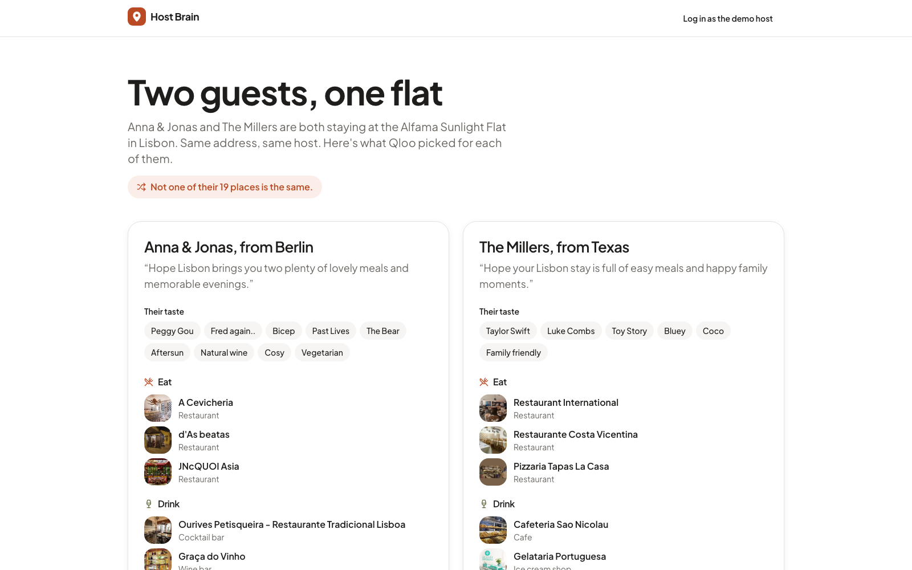
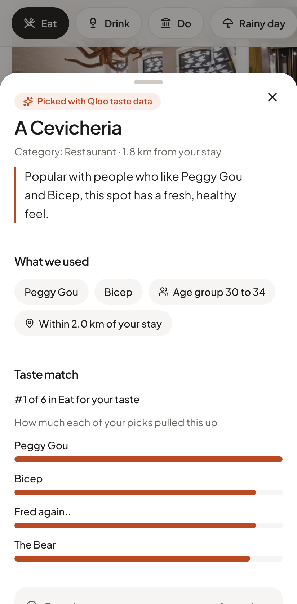
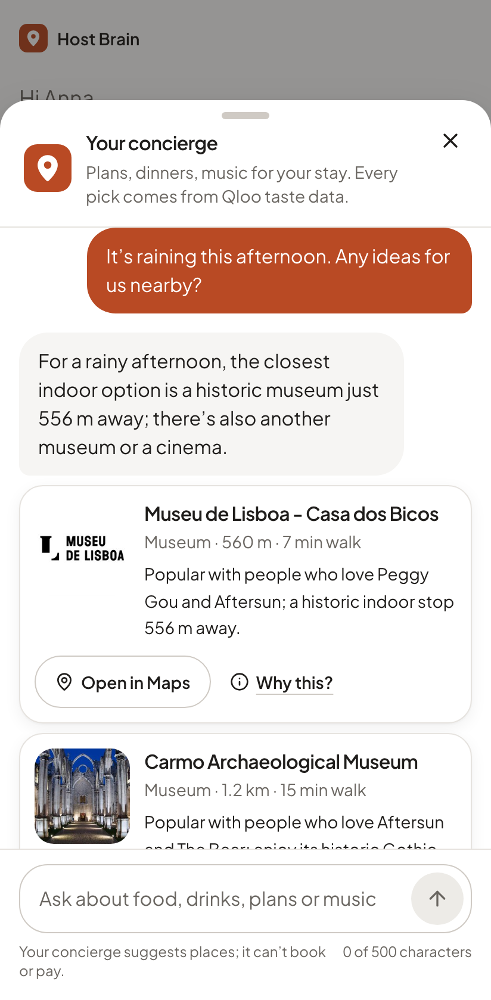
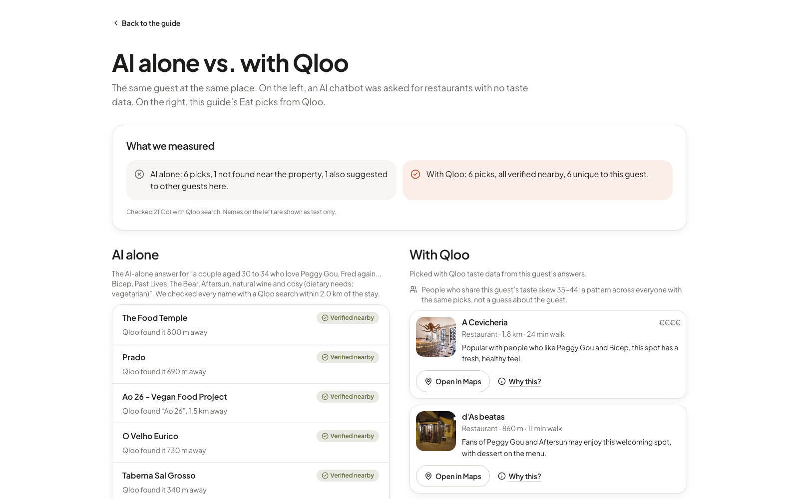
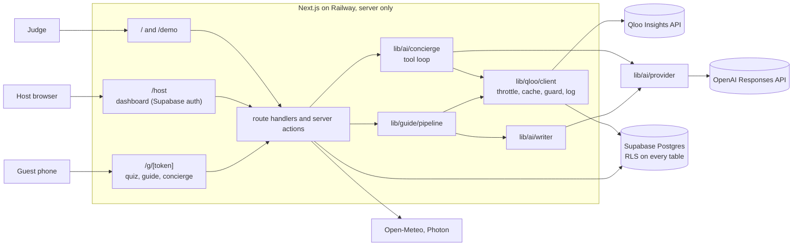
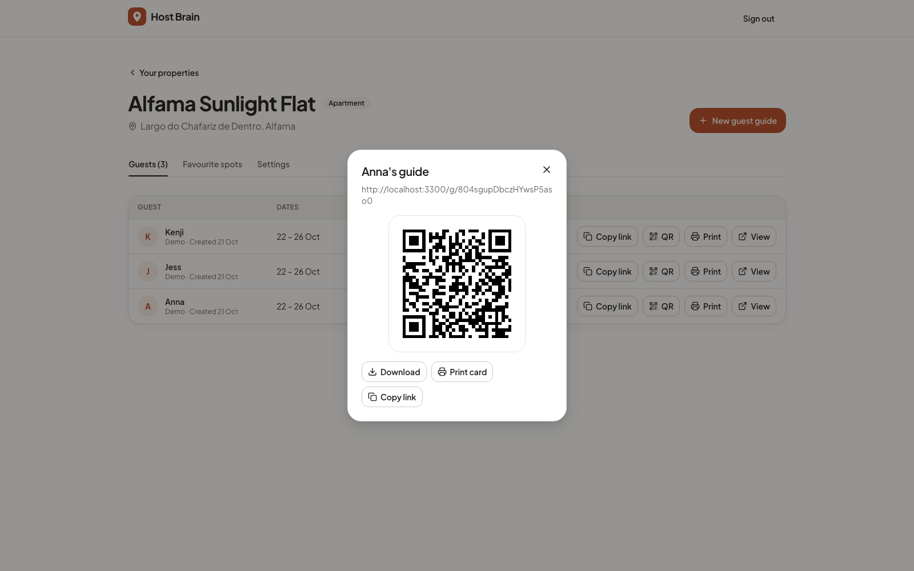

# Host Brain

**Your guests aren't the same. Why is your guidebook?**

Host Brain gives every guest of an Airbnb-style rental or a boutique hotel a personal welcome guide built from their own taste: where to eat, drink and go near the property, a rainy-day plan, a playlist and a film shelf for the stay, and the host's own favourite spots ranked for that guest. During the stay, a concierge agent answers questions like "it's raining and the kids are bored" with real places nearby.

Every recommendation comes from **[Qloo](https://qloo.com)'s taste graph**. The LLM (OpenAI) only explains, ranks and talks.

Built by [Larinera](https://larinera.com) for the [Qloo Agentic Hackathon](https://qloo.devpost.com/).

**Live demo:** [hostbrain.larinera.com/demo](https://hostbrain.larinera.com/demo) (no sign-up)

<p>
  
</p>
<p>
  
  
</p>

## The problem

Hosts hand every guest the same "top 10 restaurants" list. A couple from Berlin who love techno and natural wine and a family from Texas who love Taylor Swift and BBQ want completely different trips from the same flat. Hosts don't have the time to write a guide per guest, and a general-purpose chatbot gives everyone the same famous places, sometimes ones that don't exist.

## What it does

- **Guest guide.** The guest opens a link (no sign-up), answers a 3-step quiz (artists, films and shows, food and vibe, or "surprise me"), and gets a guide in 3 to 5 seconds: Eat, Drink, Do, Rainy day, Host's picks, a playlist, a film and TV shelf, and a map with a taste heatmap. Every card has a **Why this?** panel that shows the Qloo signal behind it, and the guide shows the guest's **taste twins** ("People who share your taste skew 30–34").
- **Concierge.** A chat agent for the stay that knows the weather, the local time and the party. It can only show places, artists and titles that a Qloo call returned in this guide or conversation. Answers with cards take about 5 to 7 seconds.
- **Host dashboard.** Properties with an address search and a map pin, up to 10 favourite spots (found through Qloo search), guest guides with status and questions asked, a link, a QR code and a printable A6 card.
- **Hotel self-serve.** A QR code in each room opens `/s/[token]`; the guest makes their own guide.
- **AI alone vs. with Qloo.** A compare view asks the LLM alone for restaurants with no taste data, checks each name against Qloo, and puts it next to the guide's Qloo picks.

## How it uses Qloo

All Qloo calls go through one server-side client (`lib/qloo/client.ts`): at most 4 requests per second and 2 in flight, retries on 429 and 5xx, a database cache, a parameter allow-list, and a log row per call.

| Call | Endpoint | What for |
|---|---|---|
| Search artists, films, TV | `/search` (`types=urn:entity:artist`, `urn:entity:movie,urn:entity:tv_show`) | Quiz type-ahead: turns "Peggy Gou" into an entity ID |
| Search places near the property | `/search` with `filter.location` | Host picks: the host searches, the server keeps only Qloo entities |
| Tags | `/v2/tags` | Cuisine and vibe chips, and the concierge's `search_tags` tool |
| Places per section | `/v2/insights` `filter.type=urn:entity:place` + `filter.location` + `filter.tags` + `signal.interests.entities` + `signal.demographics.age` + `feature.explainability` | Eat, Drink, Do, Rainy day, ranked for this guest within walking distance |
| Playlist | `/v2/insights` `filter.type=urn:entity:artist` | Artists for the stay, from the guest's own picks |
| Film and TV shelf | `/v2/insights` `filter.type=urn:entity:movie` and `urn:entity:tv_show` | Cross-domain taste: music and films in, films and shows out |
| Host picks for you | `/v2/insights` `filter.results.entities` | Ranks the host's own spots against the guest's taste ("Top match for you") |
| Taste heatmap | `/v2/insights` `filter.type=urn:heatmap` | The map layer showing which neighbourhoods match this guest |
| Taste twins | `/v2/insights` `filter.type=urn:demographics` + `signal.interests.entities` | The age group that people who love the guest's picks skew towards, shown only when it is a real skew (mean score above 0) |
| Verify AI-alone names | `/search` near the property | The compare view: does the place the LLM named exist nearby? |

Explainability (`query.explainability`) tells us which of the guest's picks pulled each result up, so "Why this?" can say *Popular with people who love …* and show the strength of each signal.

## From taste to guide (redacted example)

A synthetic walk-through of the Eat section. IDs, names and numbers are placeholders; no real Qloo response is in this repo.

**1. The guest picks** two artists and a show in the quiz. Each chip came from `/search`, so we store entity IDs, not free text:

```
artists: ["urn:…artist-1", "urn:…artist-2"]   media: ["urn:…show-1"]   tags: ["urn:tag:…:natural_wine"]
age band: 30_to_34 (picked by the host or guest; never a birth date)
```

**2. The server asks Qloo** for restaurants near the property (key and IDs redacted):

```http
GET {QLOO_BASE_URL}/v2/insights
  ?filter.type=urn:entity:place
  &filter.location=POINT(<lng> <lat>)          # the property, not the guest
  &filter.location.radius=2000
  &filter.tags=urn:tag:genre:place:restaurant
  &signal.interests.entities=urn:…artist-1,urn:…artist-2,urn:…show-1
  &signal.interests.tags=urn:tag:…:natural_wine
  &signal.demographics.age=30_to_34
  &feature.explainability=true
  &take=20
X-Api-Key: <server only>
```

No name, email, booking or location history is ever sent. `lib/qloo/guard.ts` rejects any parameter that isn't on the allow-list and any value that contains the guest's first name.

**3. Qloo returns places** ranked by affinity, each with a distance and an explainability block. We keep the top 6 after removing duplicates across sections (widening to 4 km if fewer than 6 are left):

```
1. "Lantern & Ladle"   (entity FIX-P-001)  affinity 0.8x  620 m   driven by: artist-1 (strong), show-1
2. "Casa Marmelo"      (entity FIX-P-002)  affinity 0.8x  1.1 km  driven by: artist-2
…
```

**4. The LLM writes one line per card**, from Qloo's fields only, in structured-output calls of up to five cards that start as soon as the section's Qloo results are in. The model sees short references ("1", "2", …) instead of entity IDs; the server maps them back and drops any line for a reference it didn't send:

> *Popular with people who love artist-1, and a natural-wine list to match.*

| Part of the card | Comes from |
|---|---|
| The place, its address, distance, price level, photo | Qloo |
| Its rank for this guest and the "driven by" signals | Qloo (`query.affinity`, `query.explainability`) |
| The wording of the "why you" line and the section intro | The LLM (OpenAI), constrained to the Qloo fields above |
| "Based on aggregate taste patterns of people with similar interests, not a prediction about you." | Fixed text, on every Why this? panel |

Without an OpenAI key the guide still works: each card gets a template line built from the same Qloo signals.

## AI alone vs. with Qloo

The compare view (`/g/[token]/compare`) gives the LLM the same guest description (party, age band, taste picks, no name) and the same address, and asks for six restaurants with no taste data. Each name is then looked up with Qloo search within 2 km. The page shows, side by side:

- how many AI-alone names could be found near the property at all;
- how many AI-alone names were also suggested to the other demo guests at the same flat (the "same list for everyone" effect);
- the guide's Qloo picks, each with the signals that put it there.

**What we measured** (live Qloo and OpenAI, Oct 21–22, for the couple at the Lisbon demo flat; one run, not a benchmark):

| | AI alone | With Qloo |
|---|---|---|
| Restaurants suggested | 6 | 6 |
| Found near the flat with a Qloo search (2 km) | 5 | 6 (all) |
| Not found near the flat | 1 | 0 |
| Also suggested to the other guest at the same flat | 1 | 0 (6 of 6 unique to this guest) |

Five of the chatbot's names are real places near the flat, so an LLM alone isn't useless here. The difference: nothing ties its list to what this guest loves, one name couldn't be found at all, and one was given to the family too. Every Qloo pick carries the signals that put it there. Across the whole guide, the couple and the family at the same flat share none of their 19 places.



## Speed

Measured locally against the live APIs (Oct 22):

- **Guide generation:** 3.1–5.3 s from the end of the quiz to a ready guide (Qloo responses cached, every section written fresh by the model). A run with four uncached Qloo calls took 7.5 s. Each section's lines are written as soon as its Qloo results arrive, in parallel calls of at most five items; optional sections (host picks, playlist, films, shows, heatmap, taste twins) get 9 s each and are skipped, not waited for, if Qloo is slow.
- **Concierge:** 4.8–7.1 s for an answer with cards (3–4 model calls each); an off-topic question is declined in about 1 s.

## Responsible data handling

- **No personal data to Qloo.** Only entity IDs, tag URNs, an age band and the property's location. Guest first names stay in our database and are blocked by the guard.
- **Provenance on every card.** "Why this?" shows that the pick came from Qloo, which signals drove it, and the limits line above. Guest-facing copy says "Picked with Qloo taste data".
- **The LLM never invents a venue.** The guide writer and the concierge's `show_cards` tool accept only entity IDs that a Qloo call returned in this guide or conversation; anything else is dropped and logged.
- **No raw Qloo data in git.** Test fixtures are synthetic (fictional venues, `FIX-` IDs). Live responses are cached in the database only.
- **Secrets stay on the server.** `QLOO_API_KEY`, `OPENAI_API_KEY` and the Supabase service key are read only in `server-only` modules. `pnpm build` runs `scripts/check-bundle.ts`, which fails if `QLOO`, `OPENAI_API_KEY`, an `sk-…` key, `service_role` or a configured key value shows up in the browser bundle or a prerendered page.
- **Guests need no account.** Guest pages are reachable only through a random 21-character token, are not indexed, and send no referrer. Host data is protected by row-level security on every table.

## Architecture





Stack: Next.js 16 (App Router, Cache Components), TypeScript, Tailwind CSS and shadcn/ui, Supabase (Postgres, magic-link auth, row-level security), the `openai` SDK (Responses API, strict structured outputs and function tools), MapLibre GL with OpenFreeMap tiles, Photon for address search, Open-Meteo for weather, zod for every external response, Vitest and Playwright.

## Run it locally

Needs Node 22, pnpm 10 and Docker (for the local Supabase). Without any keys the app runs in **mock mode**: Qloo answers from synthetic fixtures and the writer uses template lines.

```bash
git clone https://github.com/larineradigital/hostbrain-public.git host-brain && cd host-brain
nvm use                      # Node 22
pnpm install
cp .env.example .env.local
pnpm db:start                # local Supabase; applies migrations and the tag map seed
```

Copy the API URL, the anon key and the service-role key that `pnpm db:start` prints into `.env.local` (`NEXT_PUBLIC_SUPABASE_URL`, `NEXT_PUBLIC_SUPABASE_ANON_KEY`, `SUPABASE_SERVICE_ROLE_KEY`). Then seed the demo host, properties and guests in mock mode and start the app:

```bash
pnpm tsx --conditions=react-server scripts/seed-demo.ts --mock
pnpm dev
```

Open http://localhost:3000. `/demo` shows two guests at the same flat; on `/login`, "Log in as the demo host" opens the dashboard (only when `DEMO_MODE=true`). Host sign-in emails land in the local mailbox at http://127.0.0.1:54324.

**Live mode:** add your own `QLOO_API_KEY` (and `OPENAI_API_KEY` for the writer, the concierge and the compare view) to `.env.local` and set `QLOO_MODE=live`. `scripts/seed-demo.ts` without `--mock` then builds the demo guides from the real API, throttled.

**Checks:**

```bash
pnpm typecheck && pnpm lint && pnpm test   # unit tests
pnpm e2e                                   # Playwright, mock mode, builds the app; needs the local Supabase
pnpm build                                 # also runs the client-bundle secret check
```

`pnpm qa` runs the demo-readiness pass (console errors, 4xx/5xx, mobile and desktop, light and dark) against a server you have started, for example `pnpm build && QLOO_MODE=replay pnpm start`.

### Deploy

The live demo runs on [Railway](https://railway.com) with a hosted [Supabase](https://supabase.com) project (free tier, EU) for the database and auth. `railway.toml` is the web service (`pnpm build`, `pnpm start` on `$PORT`, health check `/api/health`, one instance); `railway.cron.toml` is a second service that runs `pnpm cleanup` daily (retention: expired cache rows, guest first names and chats 30 days after check-out; it also keeps the free Supabase project awake). To run your own:

1. **Supabase.** Create a project, then push the migrations and the quiz chips seed (without `--include-seed` the quiz has no chips; you can also paste `supabase/seed.sql` into the SQL editor):
   ```bash
   pnpm supabase login
   pnpm supabase link --project-ref <project ref>
   pnpm supabase db push --include-seed
   ```
   Under Authentication → URL Configuration, set the Site URL to your domain and add `https://<your domain>/**` as a redirect URL.
2. **Web service.** On Railway, deploy this repo as a service; it picks up `railway.toml` (`railpack.json` pins Node 22). Set the variables from the table below before the first build, because the `NEXT_PUBLIC_*` values are baked into the browser bundle. Keep one replica. `/api/health` should answer `{"ok":true,…}`.
3. **Cleanup cron.** Add a second service from the same repo, point Settings → Config-as-code at `/railway.cron.toml`, and give it `NEXT_PUBLIC_SUPABASE_URL`, `SUPABASE_SERVICE_ROLE_KEY` and `QLOO_MODE` (for example as references to the web service's variables). `pnpm cleanup --dry-run` shows locally what it would delete.
4. **Seed the demo** from your machine, with the production values in a git-ignored `.env.production.local`:
   ```bash
   QLOO_MODE=live pnpm tsx --conditions=react-server scripts/seed-demo.ts --env production
   pnpm tsx --conditions=react-server scripts/warm-cache.ts --env production
   ```
   Without `--env production` the scripts refuse a hosted Supabase.
5. **If the Qloo key stops working,** set `QLOO_MODE=replay` on the web service: the demo guides, compare view and concierge keep working from cached responses, and "Try it as a guest" opens a ready-made guide.

### Environment variables

| Variable | Default | What it does |
|---|---|---|
| `NEXT_PUBLIC_SUPABASE_URL`, `NEXT_PUBLIC_SUPABASE_ANON_KEY` | – | Supabase project (safe in the browser; RLS protects data) |
| `SUPABASE_SERVICE_ROLE_KEY` | – | Server only. Guest token routes, the pipeline and scripts |
| `QLOO_API_KEY` | – | Server only. Without it, Qloo runs in mock mode |
| `QLOO_BASE_URL` | `https://hackathon.api.qloo.com` | Qloo API base URL |
| `QLOO_MODE` | `live` with a key, else `mock` | `live`, `mock` (synthetic fixtures) or `replay` (cached responses only, for when the key or quota runs out) |
| `LLM_PROVIDER` | `openai` | LLM vendor behind `lib/ai/provider.ts` (OpenAI is the only one today) |
| `OPENAI_API_KEY` | – | Server only. Without it, the writer uses template lines and the concierge and AI-alone column say they're offline |
| `OPENAI_MODEL` | `gpt-6.1-sol` | Model for the writer, the concierge and the compare view |
| `CONCIERGE_MODE`, `COMPARE_MODE` | `live` | `replay` answers from recorded synthetic fixtures (e2e) |
| `WEATHER_MODE` | `live` | `mock` returns a fixed forecast (e2e, offline) |
| `APP_URL` | `http://localhost:3000` | Public URL (`https://hostbrain.larinera.com` in production) for QR codes, printed cards, guest links and magic-link emails. A localhost value falls back to the request's own origin |
| `DEMO_MODE` | `false` | Shows the demo-host login button and the compare links |
| `DEMO_HOST_EMAIL` | `demo-host@larinera.com` | The demo host account created by `scripts/seed-demo.ts` |
| `REPO_URL` | – | Linked from the landing page footer when set |

## Known limitations

- **Qloo quota.** The hackathon key allows 10,000 calls a month. Guides are cached for 72 hours and the demo guides are pre-generated; `QLOO_MODE=replay` keeps the demo working from cached data if the key stops working, and "Try it as a guest" then opens a ready-made guide.
- **Coverage varies by city.** Some cities have less place data; sections widen from 2 to 4 km before showing fewer cards, and the host-picks section can be missing when Qloo can't rank the host's spots.
- **One server instance.** The app runs as a single Railway instance: self-serve, "Try as a guest" and the concierge's per-guide limit are counted in the database, but the per-IP limits and the Qloo throttle are kept in memory, so more replicas would need them in the database first.
- **Free-tier Supabase.** 500 MB of database and 5 GB of egress a month, and the project pauses after 7 idle days (a daily cleanup cron keeps it active). The built-in auth email is rate-limited and meant for testing; judges use "Log in as the demo host", and real hosts need custom SMTP (for example Resend) first.
- **Shared demo account.** In `DEMO_MODE` anyone can sign in as the demo host. The seeded demo properties, picks and guides are read-only for hosts, but new guides created through "Try as a guest" are visible to anyone signed in as the demo host.
- **Local time** for the concierge comes from the property's country code (one time zone per country).
- English only; no bookings, payments or platform integrations.
- Images are loaded from Qloo's image CDN; a place without an image gets a section icon.

## License

[MIT](LICENSE) © 2026 Larinera. Built for the Qloo Agentic Hackathon. Qloo data is used under Qloo's terms and is not part of this repository.
